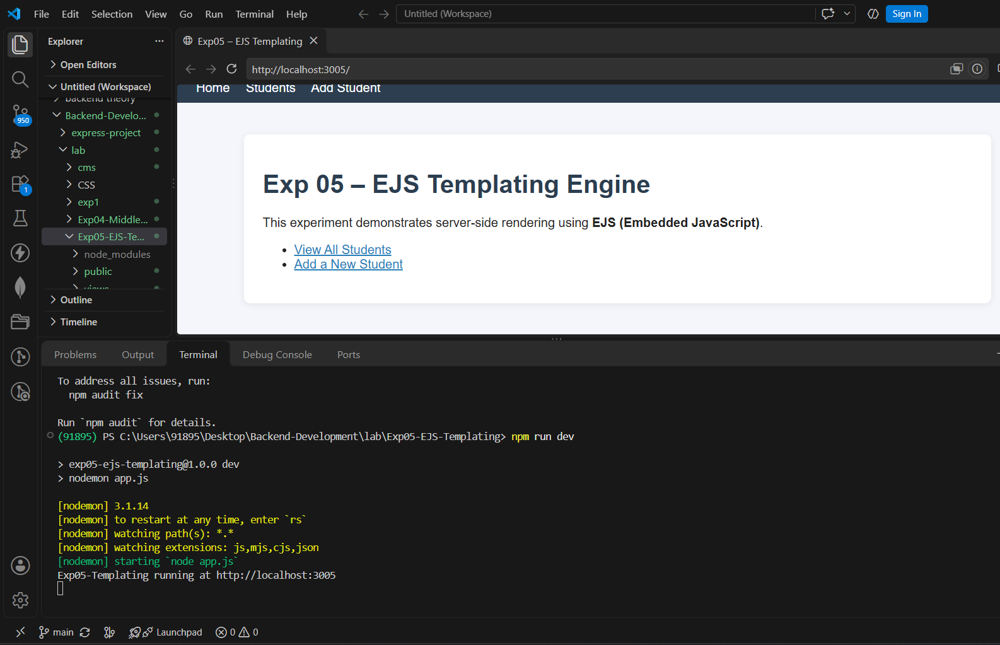
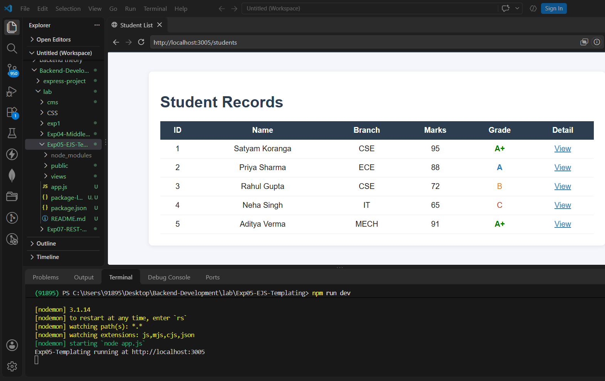
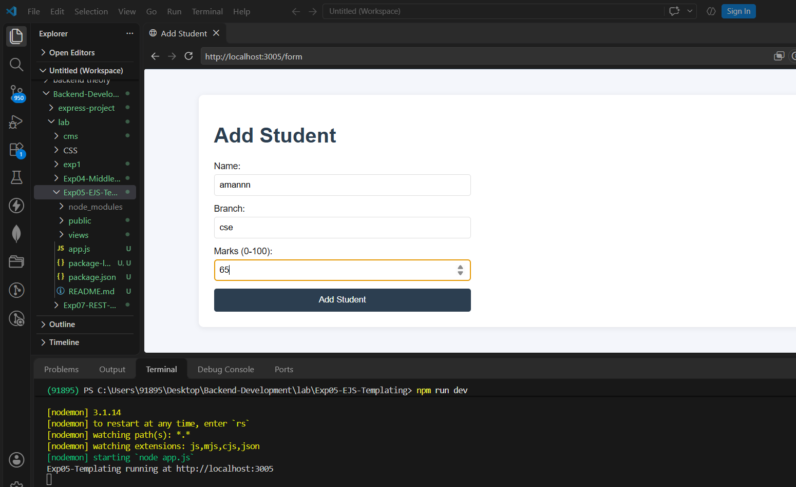

# Exp 05 – EJS Templating Engine

## Summary
Demonstrates server-side rendering (SSR) using the Embedded JavaScript (EJS) templating engine with Express. The application passes backend data to views, iterates through records, renders conditional elements, processes form data, and serves static styles.

## Syntax Reference
| Tag Syntax | Behavior | Usage |
|---|---|---|
| `<%= value %>` | Escapes and prints output | Displaying strings safely without XSS risk |
| `<% code %>` | Executes JavaScript | Evaluating loops (`forEach`) and `if/else` checks |
| `<%- html %>` | Prints raw unescaped output | Rendering formatted HTML snippets |
| `res.render()` | Invokes view engine | Compiling templates with contextual data objects |

## Directory Structure
```
Exp05-EJS-Templating/
├── app.js              # Express routing and data definitions
├── package.json        # Dependencies and execution commands
├── public/
│   └── style.css       # Static CSS stylesheet
└── views/
    ├── index.ejs       # Home view
    ├── students.ejs    # Student table view with loop iteration
    ├── student-detail.ejs # Single record view
    ├── form.ejs        # Add student submission form
    └── 404.ejs         # Custom 404 error page
```

## How to Run
```bash
cd Exp05-EJS-Templating
npm install
npm run dev
```
Open **http://localhost:3005** in your browser.

## output preview





