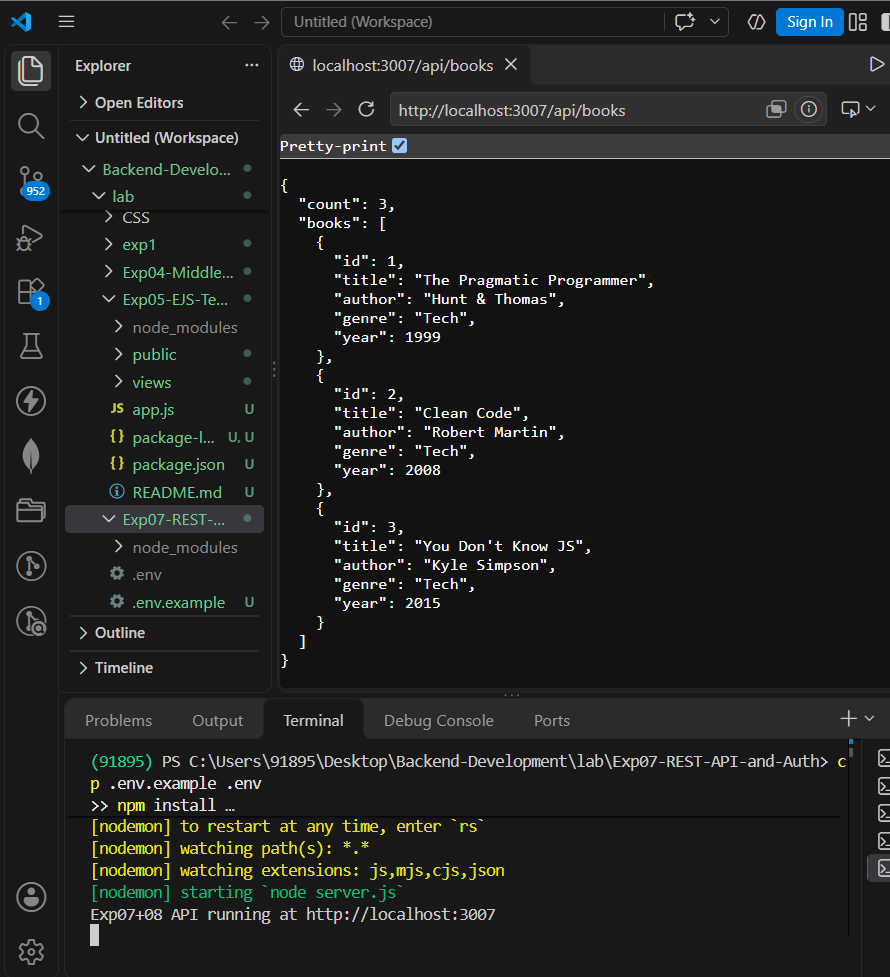
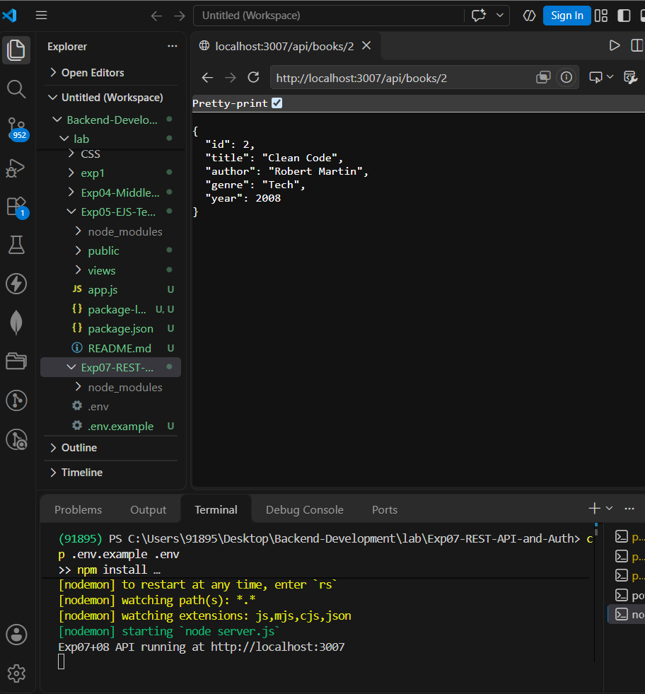
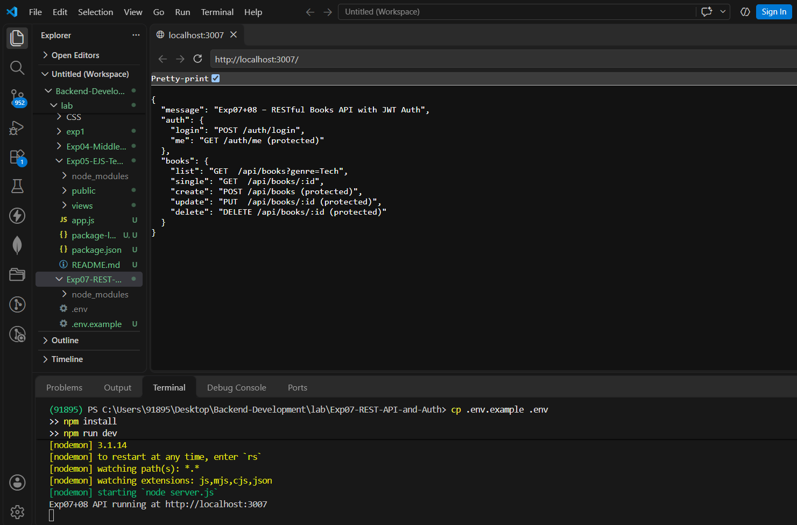
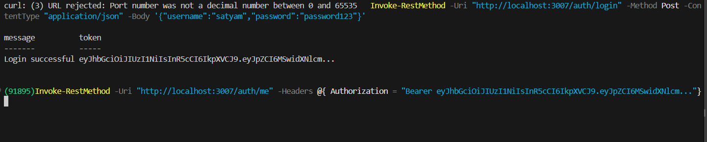
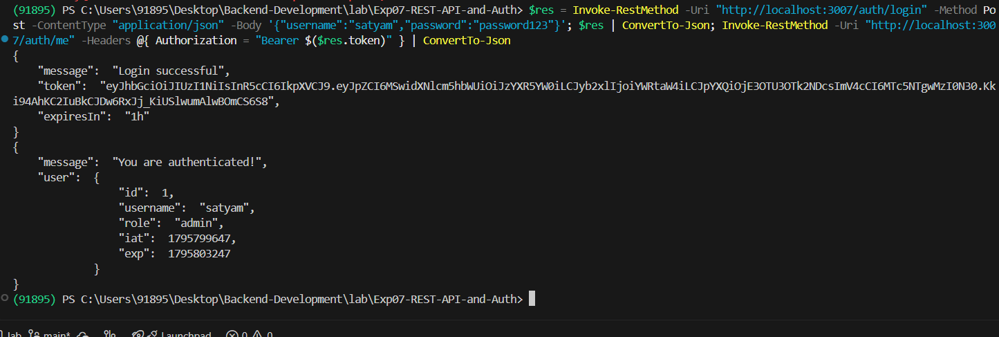

# Exp 07 & 08 – RESTful API and JWT Authentication

This experiment combines a complete RESTful CRUD API with JSON Web Token (JWT) based authentication in a unified Express service.

## Summary
- **Exp 07:** Implements a standard CRUD interface for a books catalog resource supporting filtering via query parameters.
- **Exp 08:** Adds user authentication using password hashing with bcrypt, JWT generation upon login, and route guards that verify `Authorization: Bearer <token>` headers.

## API Endpoints

### Authentication Routes (Exp 08)
| Method | Route | Access | Description |
|---|---|---|---|
| POST | `/auth/login` | Public | Submits credentials and returns a signed JWT |
| GET | `/auth/me` | Protected | Returns the decoded token payload for the current user |

## output preview for exp 08 





### Books CRUD Routes (Exp 07)
| Method | Route | Access | Description |
|---|---|---|---|
| GET | `/api/books` | Public | Lists all books; supports `?genre=` and `?author=` query filters |
| GET | `/api/books/:id` | Public | Retrieves a specific book record by its numeric identifier |
| POST | `/api/books` | Protected | Adds a new book record |
| PUT | `/api/books/:id` | Protected | Modifies attributes of an existing book record |
| DELETE | `/api/books/:id` | Protected | Deletes a book record |


## output preview for exp 07





## Source Files
```
Exp07-REST-API-and-Auth/
├── server.js        # Server logic, routes, and auth middleware
├── package.json     # Project configuration and dependencies
└── .env.example     # Template for environment variables
```

## How to Run
```bash
cd Exp07-REST-API-and-Auth
cp .env.example .env
npm install
npm run dev
```
The server will start on **http://localhost:3007**.

## Testing Endpoints with curl

```bash
# 1. Log in to retrieve a signed token
curl -X POST http://localhost:3007/auth/login \
  -H "Content-Type: application/json" \
  -d "{\"username\":\"satyam\",\"password\":\"password123\"}"

# 2. Access the protected profile route using the token
curl -H "Authorization: Bearer <TOKEN>" http://localhost:3007/auth/me

# 3. Retrieve the full book list (public)
curl http://localhost:3007/api/books

# 4. Create a new book record (protected)
curl -X POST http://localhost:3007/api/books \
  -H "Authorization: Bearer <TOKEN>" \
  -H "Content-Type: application/json" \
  -d "{\"title\":\"Node.js Design Patterns\",\"author\":\"Mario Casciaro\",\"genre\":\"Tech\",\"year\":2020}"

# 5. Delete a book record (protected)
curl -X DELETE http://localhost:3007/api/books/1 \
  -H "Authorization: Bearer <TOKEN>"
```
