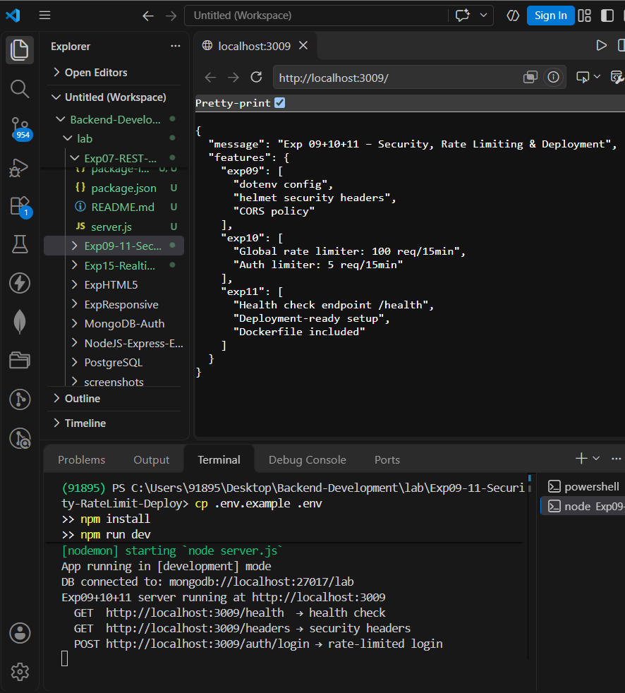
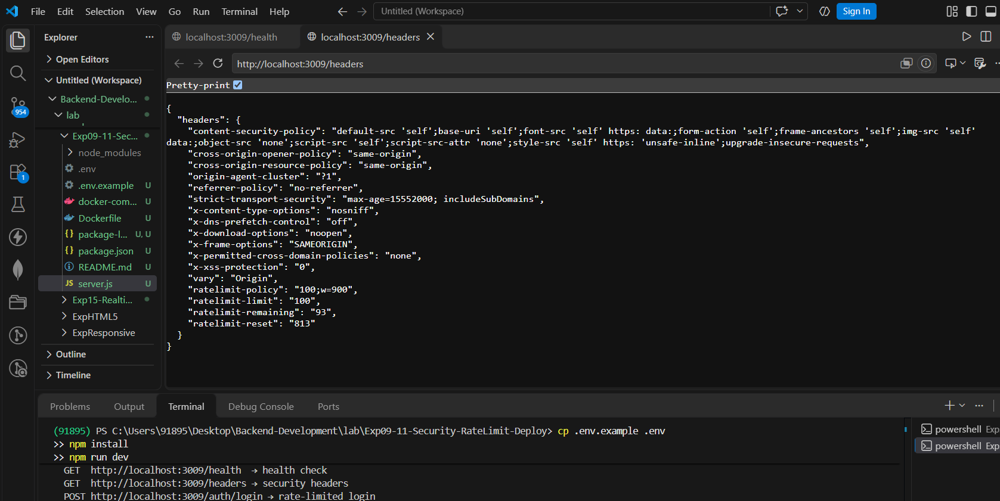
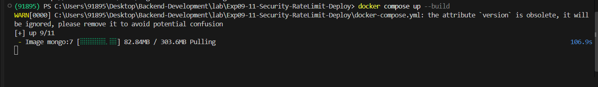
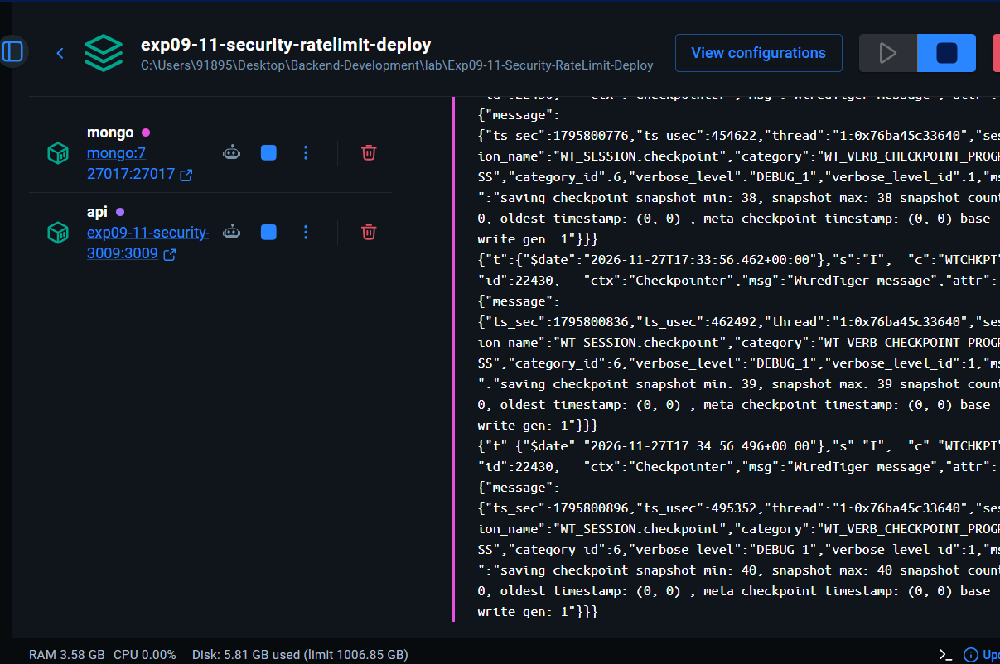
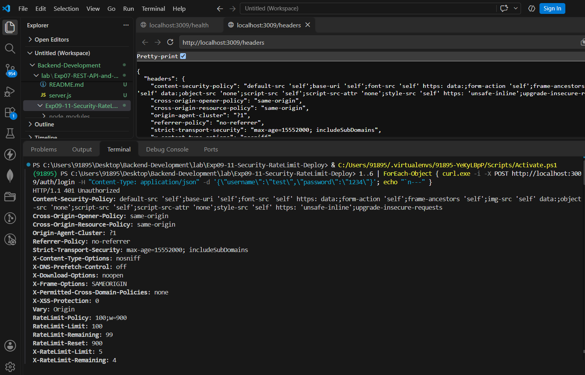
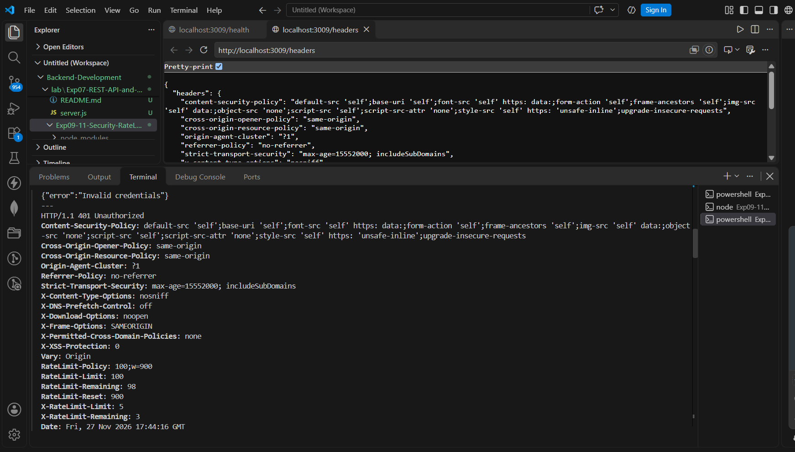
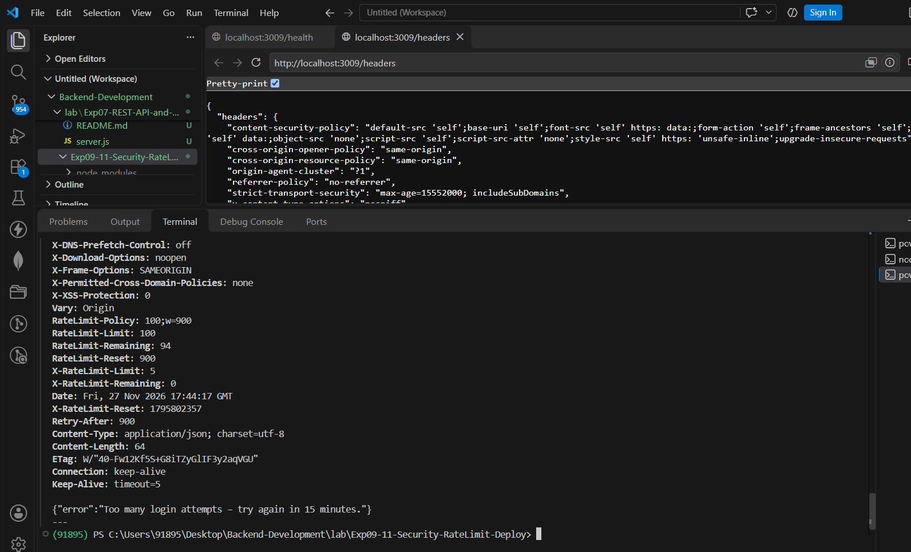
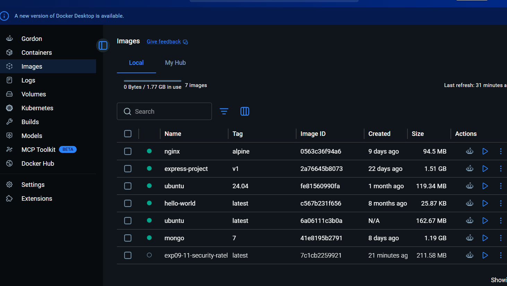
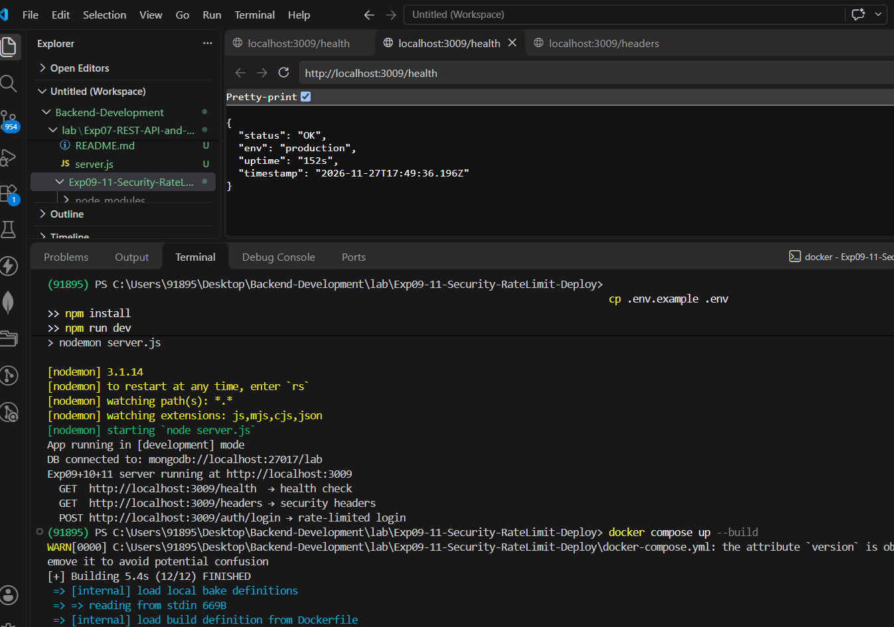

# Exp 09, 10 & 11 – Security, Rate Limiting and Deployment

This project brings together three production-oriented backend concepts into a single Express application.

## Summary

| Experiment | Area | Implementation |
|---|---|---|
| **Exp 09** | Configuration and Security | Environment loading via dotenv, Helmet security headers, CORS origin filtering |
| **Exp 10** | Traffic Management | Request rate limiting with express-rate-limit (global and auth tiers) |
| **Exp 11** | Containerized Deployment | Production Dockerfile, Docker Compose multi-container setup, `/health` endpoint |

## Directory Structure
```
Exp09-11-Security-RateLimit-Deploy/
├── server.js           # Express application with security and rate-limiting rules
├── package.json        # Dependencies and scripts
├── .env.example        # Environment variable template
├── Dockerfile          # Multi-stage production container image definition
└── docker-compose.yml  # Compose file managing the API and MongoDB services
```

## Running Locally
```bash
cd Exp09-11-Security-RateLimit-Deploy
cp .env.example .env
npm install
npm run dev
```
The server will run on **http://localhost:3009**.

## Running via Docker
```bash
# Build images and start all containers
docker compose up --build

# Stop active containers
docker compose down
```
## Output Preview
## VIA DOCKER 

## exp 9 



## exp 10




## exp 11





## Route Endpoints
| Method | Route | Description |
|---|---|---|
| GET | `/` | Service overview and configured feature set |
| GET | `/health` | Health check endpoint returning uptime and environment status |
| GET | `/headers` | Returns active response headers applied by Helmet |
| POST | `/auth/login` | Rate-limited login route (maximum 5 attempts per 15 minutes) |
