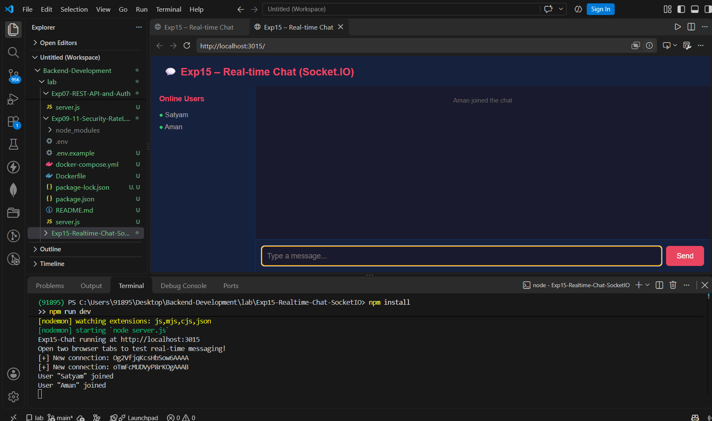
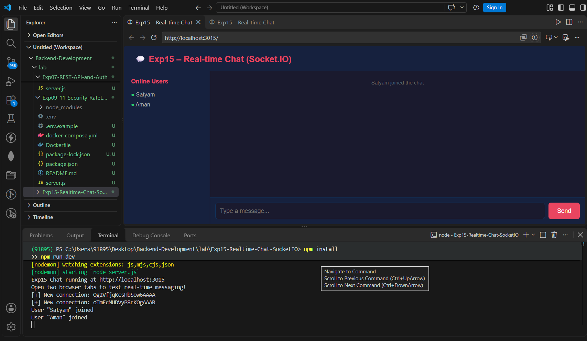
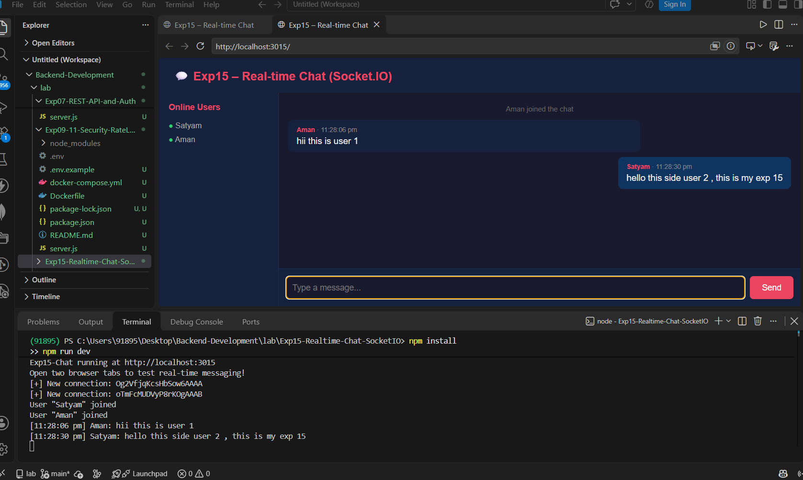

# Exp 15 – Real-time Chat with Socket.IO

## Summary
A functional group chat application demonstrating full-duplex, event-driven communication using Socket.IO and Express. The project covers client connection lifecycles, real-time message broadcasting, room-less public discussions, and active user presence tracking.

## Technical Concepts
| Concept | Implementation Details |
|---|---|
| WebSocket Connection | Managed through `io.on('connection', socket => ...)` |
| Broadcast to All | Emitted using `io.emit('message', payload)` |
| Broadcast to Others | Emitted using `socket.broadcast.emit(...)` |
| Client State | Tracked via an in-memory `users` dictionary indexed by `socket.id` |
| Disconnect Cleanup | Triggered on socket disconnection to notify peers and update the user list |

## Directory Structure
```
Exp15-Realtime-Chat-SocketIO/
├── server.js           # Express and Socket.IO server implementation
├── package.json        # Dependencies
└── public/
    └── index.html      # Responsive chat interface with Socket.IO client library
```

## How to Run
```bash
cd Exp15-Realtime-Chat-SocketIO
npm install
npm run dev
```
Open **http://localhost:3015** in two or more browser windows to test real-time chat communication.

## output preview 





