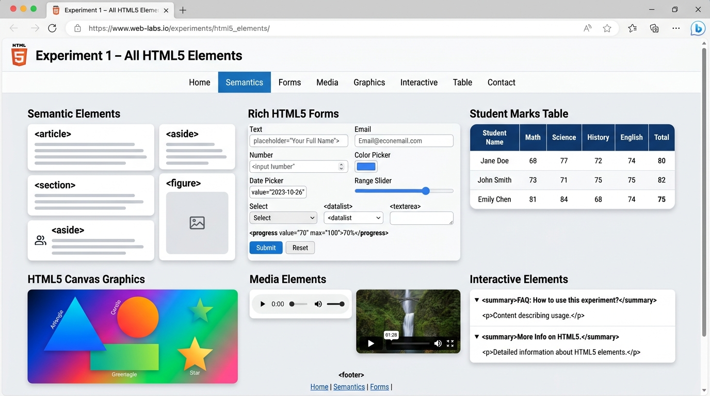
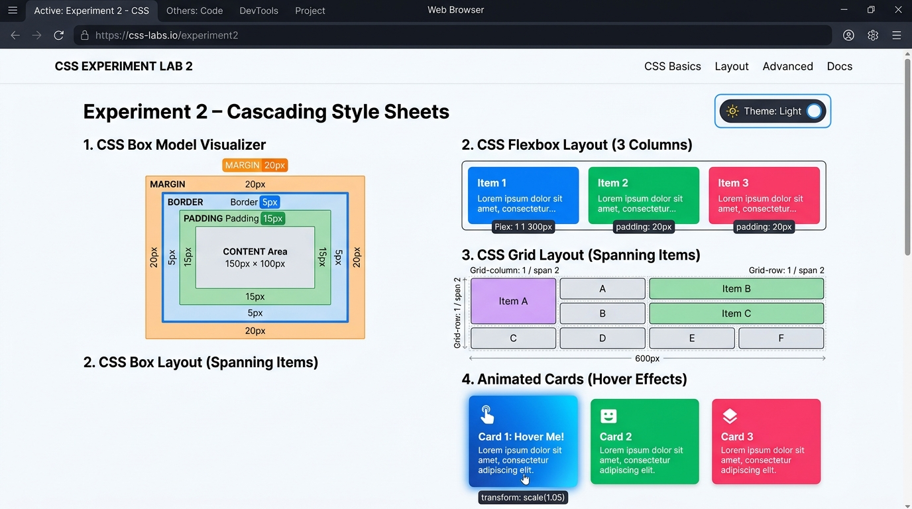
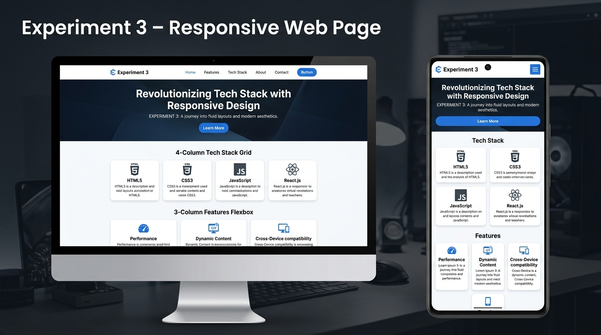

# Backend Development Laboratory Experiments

**Student:** Satyam Koranga ([@satyam-x-10](https://github.com/satyam-x-10))  
**SAP / Roll No:** 590017202  
**Institution:** UPES, Dehradun  
**Course Reference:** [UPES SoCS Backend Development Lab Manual](https://upessocs.github.io/#dir=/Lectures/Backend%20Development/Lab/&file=list.txt)

---

## Experiment Index

| # | Experiment | Directory | How to Run | Core Concepts |
|---|---|---|---|---|
| **01** | [HTML5 Elements](#exp-01--all-html5-elements) | `ExpHTML5/` | Open `index.html` in browser | Semantic markup, form controls, Canvas, SVG, native audio/video |
| **02** | [CSS Types and Selectors](#exp-02--cascading-style-sheets) | `CSS/` | Open `index.html` in browser | Specificity order, Flexbox, Grid, keyframe animations, variables |
| **03** | [Responsive Web Design](#exp-03--responsive-web-page) | `ExpResponsive/` | Open `index.html` in browser | Mobile-first breakpoints, clamp() fluid scaling, responsive navigation |
| **04** | [Express Middleware](#exp-04--express-middleware) | `Exp04-Middleware/` | `npm install && node app.js` | Request logging, custom auth guards, body parsing, error handling |
| **05** | [EJS Templating Engine](#exp-05--ejs-templating-engine) | `Exp05-EJS-Templating/` | `npm install && npm run dev` | Server-side rendering, loop structures, conditionals, form processing |
| **07 & 08** | [RESTful API and JWT Authentication](#exp-07--08--restful-api-and-jwt-authentication) | `Exp07-REST-API-and-Auth/` | `npm install && npm run dev` | Books resource CRUD, bcrypt password hashing, JWT Bearer tokens |
| **09, 10 & 11** | [Security, Rate Limiting and Deployment](#exp-09-10--11--security-rate-limiting-and-deployment) | `Exp09-11-Security-RateLimit-Deploy/` | `npm install && npm run dev` | Helmet security headers, CORS allowlists, express-rate-limit, Docker |
| **12** | [Node.js, Express and EJS](#exp-12--nodejs-express-and-ejs) | `NodeJS-Express-EJS/` | `npm install && npm run dev` | Route parameters, query strings, static asset serving, custom 404 |
| **13A** | [MongoDB Authentication System](#exp-13a--mongodb-and-express-authentication) | `MongoDB-Auth/` | `npm install && npm run dev` | Mongoose schema models, session storage, protected dashboard routes |
| **14** | [PostgreSQL Relational Database](#exp-14--postgresql-relational-database) | `PostgreSQL/` | Execute script in `psql` | DDL constraints, SQL CRUD operations, aggregations, B-tree indexes |
| **15** | [Real-time Chat with Socket.IO](#exp-15--real-time-chat-with-socketio) | `Exp15-Realtime-Chat-SocketIO/` | `npm install && npm run dev` | WebSocket bidirectional events, room-less broadcast, user presence |

---

## Exp 01 – All HTML5 Elements

**Course Outcome:** CO2 – Create and build web pages and applications  
**Overview:** A comprehensive demonstration of core HTML5 elements without third-party frameworks. It showcases semantic containers, extensive form controls with built-in validation attributes, native multimedia players, interactive tags, and direct Canvas 2D raster drawing.

### Files
- [`ExpHTML5/index.html`](ExpHTML5/index.html)

### Output Preview


### Key Features
- Semantic layout hierarchy: `header`, `nav`, `main`, `article`, `aside`, and `footer` tags.
- Form inputs: `date`, `color`, `range`, `datetime-local`, `datalist`, `progress`, and `meter`.
- Embedded graphics: Native `audio`, `video`, JavaScript Canvas 2D drawing, and vector SVG.
- Built-in interactive controls: Native modal `dialog`, collapsible `details`, and client-side `template` elements.

---

## Exp 02 – Cascading Style Sheets

**Course Outcome:** CO2 – Create and build web pages and applications  
**Overview:** Explores CSS cascading rules, selector specificity resolution (Inline > ID > Class > Element), Box Model mechanics, modern layout systems, transition smoothing, and runtime theme switching via custom properties.

### Files
- [`CSS/index.html`](CSS/index.html) (Inline and internal stylesheet rules)
- [`CSS/styles.css`](CSS/styles.css) (External stylesheet rules)

### Output Preview


### Key Features
- Specificity demonstration proving precedence between inline declarations, IDs, and classes.
- Visual representation of the Box Model showing margin, border, padding, and content bounds.
- Layout implementations using both 1D Flexbox item distribution and 2D CSS Grid column spanning.
- CSS transitions, custom keyframe animations, and light/dark theme variables under `:root`.

---

## Exp 03 – Responsive Web Page

**Course Outcome:** CO2 – Create and build web pages and applications  
**Overview:** A standalone responsive landing page constructed using pure HTML and CSS. The layout dynamically adapts between mobile, tablet, and wide desktop viewports using CSS media queries and fluid sizing calculations.

### Files
- [`ExpResponsive/index.html`](ExpResponsive/index.html)

### Output Preview


### Key Features
- Viewport configuration configured for mobile rendering engines.
- Media query breakpoints targeting standard screens (480px, 768px, and 1024px).
- Auto-fit Grid tracks using `repeat(auto-fit, minmax(280px, 1fr))` to avoid unnecessary breakpoint overhead.
- Pure JavaScript toggle logic paired with CSS transitions for the mobile navigation drawer.

---

## Exp 04 – Express Middleware

**Course Outcome:** CO3 – Develop and implement backend systems  
**Overview:** Implements the complete Express.js request-response processing pipeline. Covers custom logging, payload parsing, static asset delivery, custom token verification guards, and global error handling middleware.

### Files
- [`Exp04-Middleware/app.js`](Exp04-Middleware/app.js)
- [`Exp04-Middleware/package.json`](Exp04-Middleware/package.json)

### How to Run
```bash
cd Exp04-Middleware
npm install
node app.js
```
The application will listen at **http://localhost:3004**.

### Key Features
- Custom request logging middleware recording HTTP method, path, and UTC timestamp.
- JSON and URL-encoded request body parsing via built-in Express middleware.
- Route-level authentication guard verifying custom `x-auth-token` headers before granting access.
- Centralized 4-parameter error handler `(err, req, res, next)` catching uncaught route errors.

---

## Exp 05 – EJS Templating Engine

**Course Outcome:** CO3 – Develop and implement backend systems  
**Overview:** Demonstrates dynamic server-side rendering (SSR) using EJS templates. Covers passing data from controller routes to views, evaluating loops, rendering conditional states, and handling HTML form submissions.

### Directory Structure
```
Exp05-EJS-Templating/
├── app.js
├── package.json
├── public/style.css
└── views/
    ├── index.ejs
    ├── students.ejs
    ├── student-detail.ejs
    ├── form.ejs
    └── 404.ejs
```

### How to Run
```bash
cd Exp05-EJS-Templating
npm install
npm run dev
```
The application will listen at **http://localhost:3005**.

### Key Features
- Escaped variable output (`<%= %>`) preventing script injection vulnerabilities.
- Unbuffered JavaScript execution (`<% %>`) for iterators and conditional blocks.
- View controller routing handling both GET requests and POST record insertions.
- Multi-view architecture sharing a unified static stylesheet.

---

## Exp 07 & 08 – RESTful API and JWT Authentication

**Course Outcome:** CO3 – Develop and implement backend systems  
**Overview:** Combines a full REST API for managing a books catalog with token-based JSON Web Token authentication. Unauthenticated clients can read catalog listings, while write and delete operations require a validated Bearer token.

### Directory Structure
```
Exp07-REST-API-and-Auth/
├── server.js
├── package.json
└── .env.example
```

### How to Run
```bash
cd Exp07-REST-API-and-Auth
cp .env.example .env
npm install
npm run dev
```
The service will listen at **http://localhost:3007**.

### Route Reference
| Method | Route | Access | Description |
|---|---|---|---|
| POST | `/auth/login` | Public | Validates credentials and returns signed JWT |
| GET | `/auth/me` | Protected | Verifies Bearer token and returns user profile |
| GET | `/api/books` | Public | Lists books; supports filtering via query parameters |
| GET | `/api/books/:id` | Public | Returns a single book record by ID |
| POST | `/api/books` | Protected | Appends a new book record |
| PUT | `/api/books/:id` | Protected | Updates attributes of an existing book |
| DELETE | `/api/books/:id` | Protected | Removes an entry from the book catalog |

---

## Exp 09, 10 & 11 – Security, Rate Limiting and Deployment

**Course Outcome:** CO3 – Develop and implement backend systems  
**Overview:** Implements enterprise production patterns for Node.js backends. Manages environment configurations through dotenv, establishes security headers via Helmet, applies CORS origin controls, restricts brute-force traffic via express-rate-limit, and provides multi-container orchestration through Docker and Docker Compose.

### Directory Structure
```
Exp09-11-Security-RateLimit-Deploy/
├── server.js
├── package.json
├── .env.example
├── Dockerfile
└── docker-compose.yml
```

### How to Run Locally
```bash
cd Exp09-11-Security-RateLimit-Deploy
cp .env.example .env
npm install
npm run dev
```
The server will run at **http://localhost:3009**.

### How to Run with Docker
```bash
docker compose up --build
```

### Key Features
- Centralized configuration parsing via `dotenv` with sample variable fallbacks.
- Automated security header injection using Helmet (including X-Content-Type-Options, Frameguard, and CSP).
- Multi-tier rate limiting providing general API throttling alongside strict authentication limits.
- Containerized deployment ready for staging with `/health` heartbeat checks.

---

## Exp 12 – Node.js, Express and EJS

**Course Outcome:** CO3 – Develop and implement backend systems  
**Overview:** Foundation backend architecture demonstrating Express request handling, route parameters, query string reading, form payload parsing, and multi-template rendering using EJS.

### Files
- [`NodeJS-Express-EJS/app.js`](NodeJS-Express-EJS/app.js)
- [`NodeJS-Express-EJS/views/`](NodeJS-Express-EJS/views/)

### How to Run
```bash
cd NodeJS-Express-EJS
npm install
npm run dev
```
The application will listen at **http://localhost:3000**.

### Output Preview


---

## Exp 13A – MongoDB and Express Authentication

**Course Outcome:** CO3 – Develop and implement backend systems  
**Overview:** A persistent user authentication service built on Express, Mongoose, and MongoDB. Implements 10-round bcrypt password hashing on save, session-based state management, dashboard access control, and password projection exclusions.

### Files
- [`MongoDB-Auth/server.js`](MongoDB-Auth/server.js)
- [`MongoDB-Auth/package.json`](MongoDB-Auth/package.json)

### How to Run
Ensure a local MongoDB daemon (`mongod`) is running on port 27017, then:
```bash
cd MongoDB-Auth
npm install
npm run dev
```
The service will listen at **http://localhost:4000**.

### Output Preview


---

## Exp 14 – PostgreSQL Relational Database

**Course Outcome:** CO3 – Develop and implement backend systems  
**Overview:** Relational database management using PostgreSQL. Covers schema creation with strict constraints, CRUD queries, aggregation grouped by foreign fields, conditional evaluation with CASE, and index creation.

### Files
- [`PostgreSQL/exp14_postgresql.sql`](PostgreSQL/exp14_postgresql.sql)

### How to Run
Execute the SQL script inside `psql`:
```bash
psql -U postgres -d postgres -f PostgreSQL/exp14_postgresql.sql
```

### Output Summary
```
 branch | total_students | avg_marks 
--------+----------------+-----------
 CSE    |              3 |     92.83
 ECE    |              1 |     88.50
 IT     |              1 |     85.75
 MECH   |              1 |     79.00
```

---

## Exp 15 – Real-time Chat with Socket.IO

**Course Outcome:** CO3 – Develop and implement backend systems  
**Overview:** A full-duplex real-time communication server built with Express and Socket.IO. Demonstrates persistent WebSocket connections, room-less public broadcasting, user join/leave notifications, and live user tracking.

### Directory Structure
```
Exp15-Realtime-Chat-SocketIO/
├── server.js
├── package.json
└── public/index.html
```

### How to Run
```bash
cd Exp15-Realtime-Chat-SocketIO
npm install
npm run dev
```
Open **http://localhost:3015** across two browser tabs or windows to test real-time message broadcasting.
