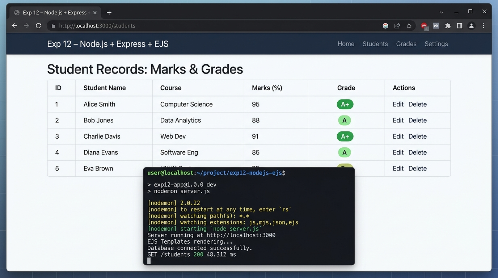
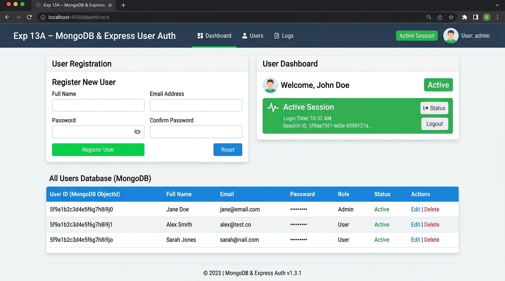

# 🚀 Backend Development Lab – UPES 2026

**Student:** Satyam Koranga
**GitHub:** [@satyam-x-10](https://github.com/satyam-x-10)
**Reference:** [Course Lab Page](https://upessocs.github.io/#dir=/Lectures/Backend%20Development/Lab/&file=list.txt)

---

## 📋 All Experiments

| # | Experiment | Folder | How to Run | Topics |
|---|-----------|--------|------------|--------|
| **01** | [HTML5 Elements](#exp-01--all-html5-elements) | `ExpHTML5/` | Open `index.html` in browser | Semantic HTML, Forms, Canvas, SVG, Media |
| **02** | [CSS Types & Selectors](#exp-02--cascading-style-sheets) | `CSS/` | Open `index.html` in browser | Inline/Internal/External CSS, Flexbox, Grid, Animations |
| **03** | [Responsive Web Design](#exp-03--responsive-web-page) | `ExpResponsive/` | Open `index.html` in browser | Media Queries, Fluid Typography, Hamburger Nav |
| **04** | [Express Middleware](#exp-04--express-middleware) | `Exp04-Middleware/` | `npm install && node app.js` | Logger, Auth Guard, Error Handler, Static Files |
| **05** | [EJS Templating](#exp-05--ejs-templating-engine) | `Exp05-EJS-Templating/` | `npm install && npm run dev` | Server-Side Rendering, Loops, Conditionals, Forms |
| **07+08** | [REST API + JWT Auth](#exp-07--08--restful-api--jwt-authentication) | `Exp07-REST-API-and-Auth/` | `npm install && npm run dev` | CRUD API, JWT Login, Protected Routes, bcrypt |
| **09+10+11** | [Security, Rate Limit & Deploy](#exp-09-10--11--security-rate-limiting--deployment) | `Exp09-11-Security-RateLimit-Deploy/` | `npm install && npm run dev` | dotenv, helmet, cors, rate-limit, Docker |
| **12** | [Node.js Express EJS](#exp-12--nodejs-npm-express-nodemon--ejs) | `NodeJS-Express-EJS/` | `npm install && npm run dev` | Express Routing, EJS Views, Params, POST |
| **13A** | [MongoDB Auth System](#exp-13a--mongodb-mongoose--express-auth) | `MongoDB-Auth/` | `npm install && npm run dev` | Mongoose, bcrypt hashing, Sessions, Dashboard |
| **14** | [PostgreSQL CRUD](#exp-14--postgresql) | `PostgreSQL/` | Run SQL in `psql` | SQL DDL/DML, Aggregations, CASE, Indexing |
| **15** | [Real-time Chat (Socket.IO)](#exp-15--real-time-chat-with-socketio) | `Exp15-Realtime-Chat-SocketIO/` | `npm install && npm run dev` | WebSockets, socket.io, Broadcast, User Tracking |

---

## Exp 01 – All HTML5 Elements

**Course Outcome:** CO2 – Create and build web pages and applications
**Summary:** Demonstrates the complete structure and semantic foundation of HTML5 — semantic layout containers, 20+ form input types, native multimedia players, HTML5 Canvas drawing, inline SVG, tables, and interactive tags.

### Files
- [`ExpHTML5/index.html`](ExpHTML5/index.html)

### Screenshots


### Key Features
- Semantic elements: `<header>`, `<nav>`, `<main>`, `<article>`, `<aside>`, `<footer>`
- HTML5 Forms: `color`, `date`, `range`, `datetime-local`, `datalist`, `progress`, `meter`
- Media & Graphics: `<audio>`, `<video>`, `<canvas>` 2D API, `<svg>`
- Interactive: `<dialog>`, `<details>`, `<template>`

---

## Exp 02 – Cascading Style Sheets

**Course Outcome:** CO2 – Create and build web pages and applications
**Summary:** Explores all three CSS types and cascading priority (Inline > ID > Class > Element). Covers Box Model, Flexbox, CSS Grid, `@keyframes` animations, transitions, and CSS variables with a Dark Theme toggle.

### Files
- [`CSS/index.html`](CSS/index.html)
- [`CSS/styles.css`](CSS/styles.css)

### Screenshots


### Key Features
- Cascading Hierarchy: Inline (1000) > ID (100) > Class (10) > Element (1)
- Box Model visualization
- Flexbox + CSS Grid layouts
- `@keyframes` animations and CSS custom properties

---

## Exp 03 – Responsive Web Page

**Course Outcome:** CO2 – Create and build web pages and applications
**Summary:** A fully responsive web page with zero external frameworks. Implements mobile-first media queries, `clamp()` fluid typography, hamburger menu, and auto-fit CSS Grid.

### Files
- [`ExpResponsive/index.html`](ExpResponsive/index.html)

### Screenshots


### Key Features
- Viewport meta tag
- Media queries: `≤480px`, `≤768px`, `≤1024px`
- `grid-template-columns: repeat(auto-fit, minmax(280px, 1fr))`
- JS hamburger toggle for mobile nav

---

## Exp 04 – Express Middleware

**Course Outcome:** CO3 – Develop and implement backend systems
**Summary:** Demonstrates the full Express middleware pipeline — custom logger, body parser, static file serving, route-level auth guard middleware, 404 handler, and global error handler.

### Files
- [`Exp04-Middleware/app.js`](Exp04-Middleware/app.js)
- [`Exp04-Middleware/package.json`](Exp04-Middleware/package.json)

### How to Run
```bash
cd Exp04-Middleware
npm install
node app.js
```
Open **http://localhost:3004**

### Key Features
- Custom logger middleware: `(req, res, next) => { console.log(...); next(); }`
- `express.json()` + `express.urlencoded()` body parsers
- Route-level auth guard using `x-auth-token` header
- Global 4-param error handler: `(err, req, res, next)`

---

## Exp 05 – EJS Templating Engine

**Course Outcome:** CO3 – Develop and implement backend systems
**Summary:** Demonstrates server-side rendering using EJS — loops with `<% %>`, output with `<%= %>`, form POST handling, dynamic routes, and a full multi-view app with static CSS.

### Files
```
Exp05-EJS-Templating/
├── app.js
├── package.json
├── public/style.css
└── views/
    ├── index.ejs
    ├── students.ejs
    ├── student-detail.ejs
    ├── form.ejs
    └── 404.ejs
```

### How to Run
```bash
cd Exp05-EJS-Templating
npm install
npm run dev
```
Open **http://localhost:3005**

### Key Features
| EJS Tag | Purpose |
|---------|---------|
| `<%= value %>` | Output HTML-escaped value |
| `<% code %>` | Execute JS (loops, conditionals) |
| `<%- html %>` | Output raw unescaped HTML |
| `res.render('view', data)` | Render template with data |

---

## Exp 07 & 08 – RESTful API + JWT Authentication

**Course Outcome:** CO3 – Develop and implement backend systems
**Summary:** Exp 07 implements a full CRUD REST API for a `Books` resource. Exp 08 adds JWT-based login (`POST /auth/login`) and protected routes using `Authorization: Bearer <token>` headers.

### Files
```
Exp07-REST-API-and-Auth/
├── server.js        ← Combined CRUD API + JWT Auth
├── package.json
└── .env.example
```

### How to Run
```bash
cd Exp07-REST-API-and-Auth
cp .env.example .env
npm install
npm run dev
```
Open **http://localhost:3007**

### API Endpoints
| Method | Route | Auth | Description |
|--------|-------|------|-------------|
| POST | `/auth/login` | Public | Login → returns JWT token |
| GET | `/auth/me` | 🔒 | View token payload |
| GET | `/api/books` | Public | List all books |
| GET | `/api/books/:id` | Public | Get single book |
| POST | `/api/books` | 🔒 | Create book |
| PUT | `/api/books/:id` | 🔒 | Update book |
| DELETE | `/api/books/:id` | 🔒 | Delete book |

---

## Exp 09, 10 & 11 – Security, Rate Limiting & Deployment

**Course Outcome:** CO3 – Develop and implement backend systems
**Summary:**
- **Exp 09:** Loads config from `.env` via `dotenv`, applies `helmet` (11 HTTP security headers), and enforces CORS with an origin allowlist.
- **Exp 10:** Adds `express-rate-limit` with global (100 req/15min) and strict auth (5 req/15min) limiters.
- **Exp 11:** Includes a `Dockerfile` and `docker-compose.yml` for containerized deployment, plus a `/health` endpoint.

### Files
```
Exp09-11-Security-RateLimit-Deploy/
├── server.js           ← Exp09+10+11 combined
├── package.json
├── .env.example
├── Dockerfile          ← Docker image
└── docker-compose.yml  ← API + MongoDB containers
```

### How to Run (Local)
```bash
cd Exp09-11-Security-RateLimit-Deploy
cp .env.example .env
npm install
npm run dev
```
Open **http://localhost:3009**

### How to Run (Docker)
```bash
docker compose up --build
```

---

## Exp 12 – Node.js, NPM, Express, Nodemon & EJS

**Course Outcome:** CO3 – Develop and implement backend systems
**Summary:** Full Express server demonstrating HTTP response types, URL route parameters, query strings, POST form handling, and EJS template rendering.

### Files
- [`NodeJS-Express-EJS/app.js`](NodeJS-Express-EJS/app.js)
- [`NodeJS-Express-EJS/views/`](NodeJS-Express-EJS/views/)

### How to Run
```bash
cd NodeJS-Express-EJS
npm install
npm run dev
```
Open **http://localhost:3000**

### Screenshots


---

## Exp 13A – MongoDB, Mongoose & Express Auth

**Course Outcome:** CO3 – Develop and implement backend systems
**Summary:** Secure user registration & login with Mongoose, bcrypt hashing (10 salt rounds), session-based auth, protected dashboard, and safe user projection (excluding password).

### Files
- [`MongoDB-Auth/server.js`](MongoDB-Auth/server.js)
- [`MongoDB-Auth/package.json`](MongoDB-Auth/package.json)

### How to Run
```bash
cd MongoDB-Auth
npm install
npm run dev
```
Open **http://localhost:4000**

### Screenshots


---

## Exp 14 – PostgreSQL

**Course Outcome:** CO3 – Develop and implement backend systems
**Summary:** Demonstrates relational database fundamentals — table creation with constraints, CRUD operations, aggregations (`GROUP BY`, `AVG`), `CASE` grade classification, and indexing.

### Files
- [`PostgreSQL/exp14_postgresql.sql`](PostgreSQL/exp14_postgresql.sql)

### Run the SQL Script
```bash
psql -U postgres
\i C:/Users/91895/Desktop/Backend-Development/lab/PostgreSQL/exp14_postgresql.sql
```

### Sample Output
```sql
 branch | total_students | avg_marks
--------+----------------+-----------
 CSE    |              3 |     92.83
 ECE    |              1 |     88.50
 IT     |              1 |     85.75
 MECH   |              1 |     79.00
```

---

## Exp 15 – Real-time Chat with Socket.IO

**Course Outcome:** CO3 – Develop and implement backend systems
**Summary:** A fully functional real-time group chat app using Socket.IO — WebSocket-based bidirectional communication, online user list, join/leave system notifications, and a styled dark-themed chat UI.

### Files
```
Exp15-Realtime-Chat-SocketIO/
├── server.js
├── package.json
└── public/
    └── index.html   ← Full chat UI with socket.io client
```

### How to Run
```bash
cd Exp15-Realtime-Chat-SocketIO
npm install
npm run dev
```
Open **http://localhost:3015** — open **two tabs** to test real-time messaging!

### Key Concepts
| Socket.IO Event | Description |
|----------------|-------------|
| `io.emit(...)` | Send event to ALL connected clients |
| `socket.broadcast.emit(...)` | Send to all EXCEPT sender |
| `socket.on('disconnect', ...)` | Handle client disconnect |
| `users[socket.id] = username` | Track connected users |
