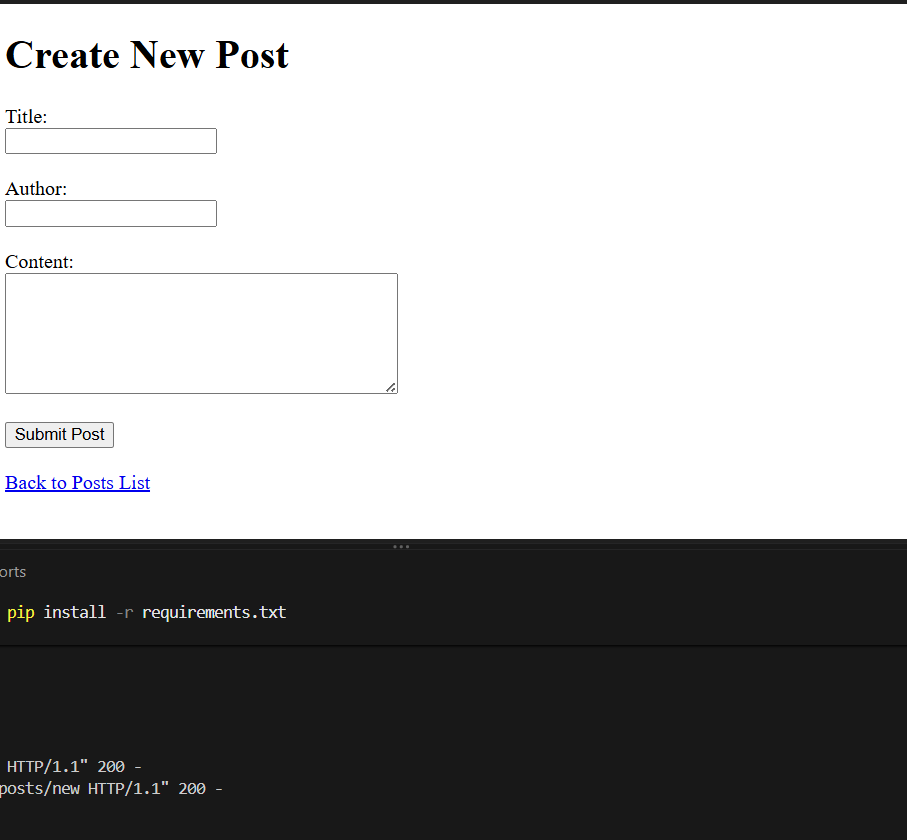
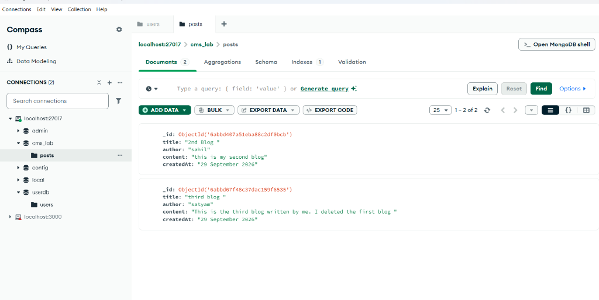

# CMS Application — Containerized with Docker

A simple Content Management System built with Flask that lets you create, view, update, and delete blog posts. The application stores data in a JSON file inside a mounted Docker volume, so your posts survive container restarts and rebuilds.

## Technologies Used

- Python 3.11
- Flask
- MongoDB (optional, used if running locally with Mongo installed)
- Docker
- JSON file storage (used inside Docker when MongoDB is not available)

## Application Features

- Create a new post with title, author, and content
- View all posts on the home page
- Read the full content of any individual post
- Edit an existing post
- Delete a post

## Application Previews

### Posts Overview
Displays all saved blog posts with title, author name, and date. Each post has Edit and Delete actions inline.


### Create Post Form
Input form for composing and submitting new articles.



### Individual Post View
Full post content along with server request logs.


### Database View
MongoDB Compass showing stored documents.



---

## Directory Structure

```text
cms/
├── app.py
├── Dockerfile
├── .dockerignore
├── requirements.txt
├── README.md
├── docker-data/
│   └── posts.json        (created at runtime — persists post data)
├── templates/
│   ├── posts.html
│   ├── post.html
│   ├── new-post.html
│   └── edit-post.html
├── static/
│   └── style.css
└── screenshots/
```

---

## Endpoints and Routes

| Method | Route | Description |
| :--- | :--- | :--- |
| GET | `/` or `/posts` | Lists all posts |
| GET | `/posts/new` | Renders the create post form |
| POST | `/posts` | Saves a new post |
| GET | `/posts/<id>` | Shows full content of a post |
| GET | `/posts/<id>/edit` | Renders the edit form for a post |
| POST | `/posts/<id>/edit` | Saves the edited post |
| POST | `/posts/<id>/delete` | Deletes a post |

---

## Local Setup (without Docker)

Make sure Python is installed, then run from inside the `cms/` directory:

```bash
pip install -r requirements.txt
python app.py
```

Open the application at:

```
http://localhost:5000
```

If MongoDB is running locally, the app connects to it automatically. If not, it falls back to saving posts in a JSON file at `./data/posts.json`.

---

## Docker Setup

### Build the Image

From inside the `cms/` directory:

```bash
docker build -t cms-app:v1 .
```

Verify the image was created:

```bash
docker images
```

### Run the Container with Persistent Storage

On Linux or macOS:

```bash
docker run -d \
  --name cms-app \
  -p 8080:5000 \
  -v "$(pwd)/docker-data:/app/data" \
  cms-app:v1
```

On Windows PowerShell:

```powershell
docker run -d `
  --name cms-app `
  -p 8080:5000 `
  -v "${PWD}/docker-data:/app/data" `
  cms-app:v1
```

### Application URL

```
http://localhost:8080
```

---

## Volume Mapping

The flag `-v "${PWD}/docker-data:/app/data"` maps the local `docker-data/` folder on your machine to `/app/data` inside the container. Flask writes `posts.json` into `/app/data`, which means every post you create is actually saved in the `docker-data/` folder on your host. That folder is never deleted when you stop or remove the container.

---

## Data Persistence Test

Create one or more posts in the browser, then stop and remove the container:

```bash
docker stop cms-app
docker rm cms-app
```

Start a brand new container using the same volume:

```powershell
docker run -d `
  --name cms-app `
  -p 8080:5000 `
  -v "${PWD}/docker-data:/app/data" `
  cms-app:v1
```

Open `http://localhost:8080` again. All previously created posts are still there because they were saved in `docker-data/posts.json` on your host machine.

---

## Useful Docker Commands

```bash
# Build the image
docker build -t cms-app:v1 .

# Run the container with a volume
docker run -d --name cms-app -p 8080:5000 -v "${PWD}/docker-data:/app/data" cms-app:v1

# List running containers
docker ps

# View container logs
docker logs cms-app

# Open a shell inside the running container
docker exec -it cms-app sh

# Stop the container
docker stop cms-app

# Remove the container
docker rm cms-app
```
