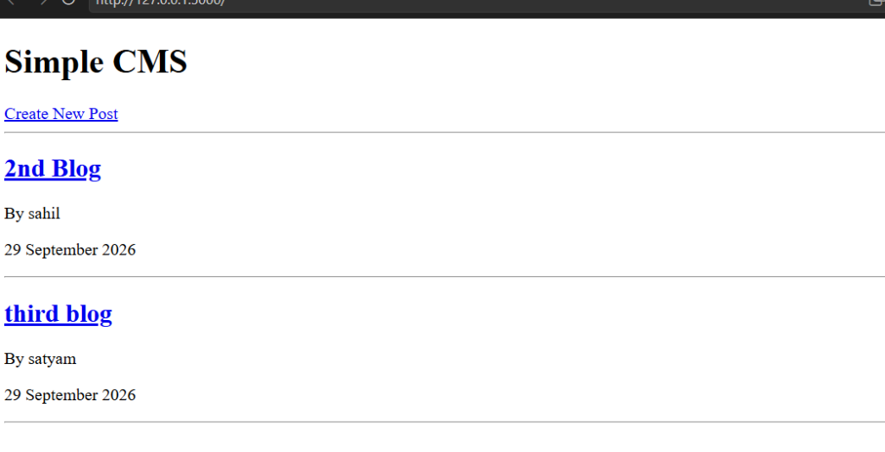
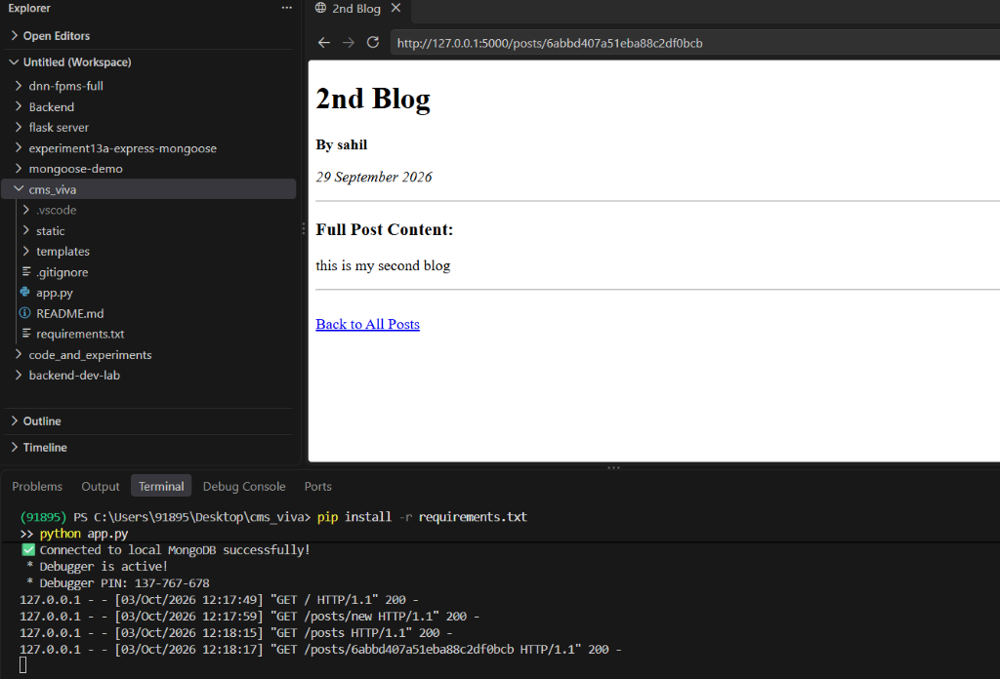

# Content Management System (CMS Laboratory Project)

A server-side rendered blog content management application built with Python, Flask, PyMongo, and Jinja2 templates, storing records in a local MongoDB database.

---

## Application Previews

### 1. Posts Overview (`GET /` and `GET /posts`)
Displays all saved blog posts including title, author name, and publication date. The post body content is excluded from the listing query projection for better performance.


---

### 2. Create Post Form (`GET /posts/new` and `POST /posts`)
Provides an input form for composing and submitting new articles. Validates required fields, appends a server-generated timestamp, and persists the document into MongoDB.


---

### 3. Individual Post View (`GET /posts/<id>`)
Queries MongoDB using the unique BSON ObjectId and displays the full post content along with active server request logs in the terminal.


---

### 4. Database Collection View (`cms_lab.posts`)
View from MongoDB Compass showing stored documents inside the `cms_lab` database under the `posts` collection.


---

## Directory Structure

```text
cms/
├── app.py                # Flask application routes and PyMongo database queries
├── requirements.txt      # Python dependencies (Flask, pymongo)
├── screenshots/          # Application preview captures
│   ├── 01_cms_home_posts_list.png
│   ├── 02_cms_create_new_post.png
│   ├── 03_cms_post_detail_vscode.png
│   └── 04_cms_mongodb_compass.png
├── static/
│   └── style.css         # Stylesheet
├── templates/
│   ├── posts.html        # Post listing template
│   ├── new-post.html     # Create post form template
│   └── post.html         # Single post detail template
└── README.md             # Project documentation
```

---

## Endpoints and Routes

| Method | Route | Description | Rendered Template |
| :--- | :--- | :--- | :--- |
| **GET** | `/` or `/posts` | Lists all posts with projected fields (title, author, createdAt) | `templates/posts.html` |
| **GET** | `/posts/new` | Renders the new post submission form | `templates/new-post.html` |
| **POST** | `/posts` | Validates input, writes to `cms_lab.posts`, and redirects to listing | Redirects to `/posts` |
| **GET** | `/posts/<id>` | Retrieves a specific document by its ObjectId | `templates/post.html` |

---

## Document Schema (Collection: `posts`)

```json
{
  "_id": "6abbd407a51eba88c2df0bcb",
  "title": "Sample Blog Title",
  "author": "Satyam",
  "content": "Detailed post content goes here.",
  "createdAt": "26 November 2026"
}
```

---

## Setup and Execution

### 1. Prerequisites
- Python 3.8 or higher installed.
- MongoDB daemon running locally on port 27017.

### 2. Install Dependencies and Launch Server
```bash
cd lab/cms
pip install -r requirements.txt
python app.py
```

### 3. Open in Browser
- Post Overview: [http://127.0.0.1:5000/posts](http://127.0.0.1:5000/posts)
- Create Post Form: [http://127.0.0.1:5000/posts/new](http://127.0.0.1:5000/posts/new)

---

## Features
- Direct database connectivity using `pymongo.MongoClient` with fallback handling.
- Server-side rendering using Jinja2 template inheritance.
- Safe resource querying via BSON `ObjectId` parsing.
- Server-generated timestamps on document insertion.
